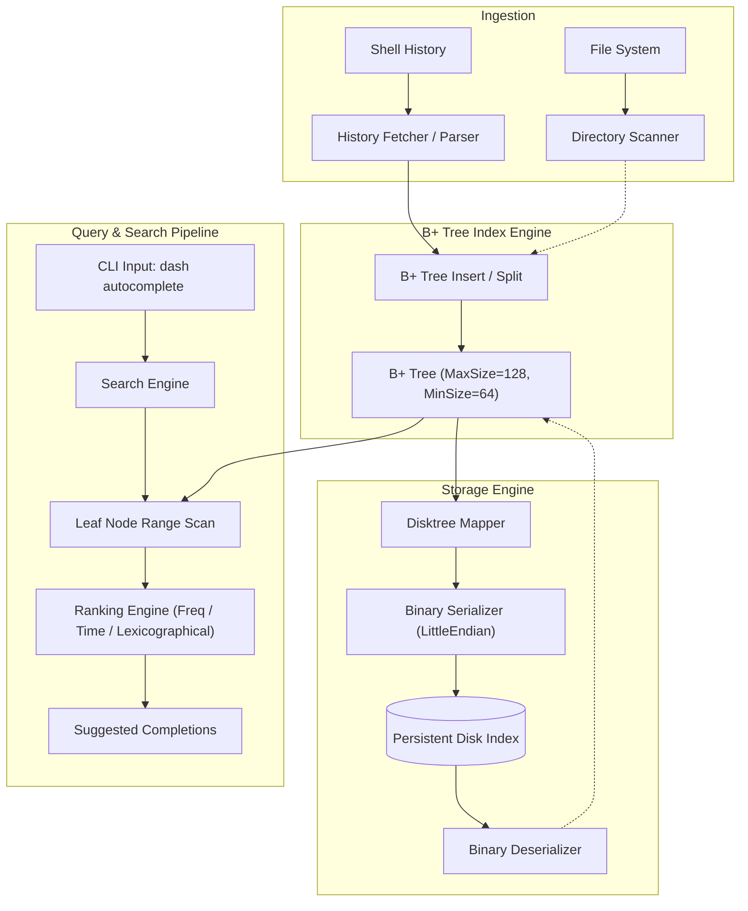

# Dash - High-Performance Shell Autocomplete Engine

## 1. Project Overview
> Dash is a high-performance shell autocomplete engine built in Go. Rather than relying on simple linear scans or in-memory hash maps, Dash implements a custom B+ Tree indexing and storage engine to provide sub-microsecond prefix searches, usage-based ranking, and command discovery across shell history and file paths.

- **Status**: `active`
- **Category**: `personal`
- **Repository**: [https://github.com/jsndz/dash](https://github.com/jsndz/dash)
- **Lead / Collaborators**: jsndz (<jaisondz9360@gmail.com>)
- **Timeline**: June 2026 – Present

## 2. Problem Statement
> Traditional shell history search tools either run full linear scans across flat text files on each keystroke or load unstructured lists into memory. As shell histories grow to tens of thousands of commands, linear scans introduce latency spikes, lack index persistence across process re-launches, and cannot naturally perform ordered range scans or disk page caching common in database storage engines. Dash demonstrates how database storage and indexing primitives (B+ Trees, disk page serialization, range scans) can be applied directly to developer tooling for near-zero-latency completions.

## 3. Objectives & Success Criteria
- [x] Custom B+ Tree supporting dynamic insertion, key split, leaf borrowing/merging, and deletion
- [x] Range-scan-based prefix completion retrieving matched commands in $O(\log N + K)$ time
- [x] History-aware ranking engine sorting suggestions by frequency and recency
- [x] Custom compact binary disk serialization and deserialization for index persistence
- [x] Comprehensive test suite and benchmark harness validating sub-microsecond lookup throughput
- [ ] Directory and filepath indexing pipeline integration
- [ ] Typo-tolerant fuzzy matching engine
- **Measure of success / Deliverable**: Point lookups under 60 ns (zero allocations), prefix queries under 5 µs, and end-to-end binary deserialization exceeding 350 MB/s.

## 4. Tech Stack
- **Languages**: Go (1.25.4)
- **Frameworks & Libraries**: Go standard library (`bytes`, `encoding/binary`, `sort`, `path/filepath`, `io`, `os`, `time`, `testing`)
- **Database & Storage**: Custom disk-backed B+ Tree (`Disktree`), little-endian binary page format
- **Infrastructure & Tools**: Go test & benchmark runner (`go test -bench`), Git, Linux / Bash shell environment

## 5. GitHub Repository & Automation Sync
- **Repository URL**: [https://github.com/jsndz/dash](https://github.com/jsndz/dash)
- **Documentation Source Path**: `docs/`
- **Sync Notes**: Maintained by AI coding agents; sync triggers on release/main push.

## 6. Architecture & System Design
> Dash follows a modular architecture: commands from shell history or directory scans are ingested by the indexer, arranged inside a B+ Tree index, searched via leaf range scans, sorted through the ranking engine, and persisted to disk via a binary page serialization layer.

## 7. Key Features
- **B+ Tree Indexing Engine**: High-fanout B+ Tree with configurable node orders (`MaxSize`, `MinSize`) supporting split-up-to-root, leaf borrowing, and internal node merging.
- **Prefix Range Scans**: Direct logarithmic leaf lookup followed by $O(K)$ sequential leaf pointer traversal (`Next`), eliminating unnecessary node traversals.
- **Usage-Based Ranking**: Ranks matching commands dynamically based on invocation frequency, last-used timestamp, and deterministic lexicographical tie-breaking.
- **Compact Binary Persistence**: Little-endian disk format preserving parent/child/sibling node IDs and command metadata with zero external dependencies.
- **Directory Path Autocomplete**: Real-time directory traversal scanner for filesystem path completions.

## 8. Implementation Details
> Core modules, data structures, and benchmark metrics.

- **B+ Tree Node Structure**:
  - Leaf and internal nodes distinguished via `IsLeaf` flag.
  - Linked leaf nodes using `Next` and `Prev` pointers for bidirectionally traversable range scans.
  - Logarithmic key searching using binary search (`sort.Search`) for both internal separators and leaf keys.
- **Disk Page Representation**:
  - In-memory pointer graph is converted into ID-indexed `DiskNode` arrays via `SetupMap` and recursive preorder traversal.
- **Binary Codec**:
  - Custom little-endian binary layout: 8-byte IDs, 4-byte string lengths, Unix int64 timestamps, and uint64 counters.
- **Performance Benchmarks** (AMD Ryzen 7 7840HS, Linux amd64):
  - **Search Hit ($N=1{,}000$)**: 32.55 ns/op (0 B/op, 0 allocs/op)
  - **Search Hit ($N=10{,}000$)**: 57.34 ns/op (0 B/op, 0 allocs/op)
  - **Search Miss**: 25.54 ns/op (0 B/op, 0 allocs/op)
  - **Range Scan (5 matches)**: 133.8 ns/op (120 B/op, 4 allocs/op)
  - **Range Scan (500 matches)**: 3.91 µs/op (9.3 KB/op, 10 allocs/op)
  - **Autocomplete vs Linear Scan ($N=50{,}000$)**: Dash B+ Tree is ~37% faster per query than linear slice iteration (12.1 µs vs 19.3 µs) with deterministic logarithmic scaling.
  - **Storage Deserialization**: ~396 MB/s throughput.

## 9. Technical Decisions
- **Decision 1: B+ Tree over Tries or Hash Maps**: [[Decision-BPlusTree-Over-Trie]] — While tries are conventional for prefix search, B+ Trees store ordered keys with high fanout (branching factor 64–128), offer superior CPU cache locality over pointer-heavy trie nodes, and align naturally with 4KB disk page persistence models.
- **Decision 2: Direct Binary Packing over Reflection/JSON**: [[Decision-Binary-Serialization]] — Implemented custom little-endian binary read/write routines rather than `encoding/json` or `encoding/gob` to achieve zero reflection overhead, fixed-width parsing, and high deserialization throughput (~400 MB/s).
- **Decision 3: In-Memory B+ Tree with Snapshot Persistence**: [[Decision-Snapshot-Persistence]] — Keeping the working B+ tree in memory while writing full snapshot page sets to disk eliminates continuous disk sync overhead during interactive shell typing.

## 10. Challenges & Solutions
| Challenge | Impact | Chosen Solution |
| :--- | :--- | :--- |
| Internal and leaf node deletions causing underflow | Risk of broken invariant constraints or dangling child pointers | Implemented bidirectional sibling borrowing with separator key updates; fallback to node merging with parent key demotion. |
| Pointer-based graph persistence | Tree node pointers (`*Node`) cannot be directly written to flat disk files | Developed `Generate()` with a pointer-to-uint64 mapping pass (`SetupMap`), storing relative `ChildrenID`, `ParentID`, `PrevID`, and `NextID` references. |
| In-place prefix range scanning | Scanning entire tree for prefixes would degrade lookup to $O(N)$ | Implemented `FindLeaf()` to seek the first leaf containing the prefix via binary search, then linearly traversed leaf `Next` pointers until the prefix no longer matched. |

## 11. Learnings & Retrospective
- **Key Technical Insights**:
  - B+ Tree fanout dramatically reduces tree height: with `MaxSize=128`, a tree storing 10,000 items requires only 2 to 3 levels, explaining the sub-60 ns search times.
  - Zero-allocation searches (`0 B/op`) in Go are achievable by returning pointers directly to node value structs without intermediate interface conversions or slice allocations.
- **What Went Well**:
  - The B+ Tree implementation is robust, passing complex random fuzzing, insertion/deletion balance validation, and serialization round-trips.
- **What Could Be Improved**:
  - Binary serialization currently serializes full snapshots; transitioning to an append-ahead log (WAL) or page-level cache will enable incremental updates.

## 12. Future Improvements & Roadmap
- [ ] Implement fuzzy matching (Levenshtein distance / ngram indexing) for typo tolerance (e.g. `gco` $\to$ `git checkout`)
- [ ] Zsh, Fish, and PowerShell history format parser support
- [ ] Incremental Write-Ahead Log (WAL) and memory-mapped file (`mmap`) support for persistent index storage
- [ ] Shell integration scripts (Zsh ZLE widget, Bash `bind`)
- [ ] Context-aware completions (git branch awareness, repository root discovery)

## 13. Related Concepts & Notes
- Concepts: [[B-Plus-Trees]], [[Database-Indexing]], [[Range-Scan-Algorithms]], [[Binary-Serialization]], [[Information-Retrieval]]
- Resources: [[B-Plus-Tree-Documentation]]
- Originating Ideas: [[High-Performance-Shell-Autocompletion]]
